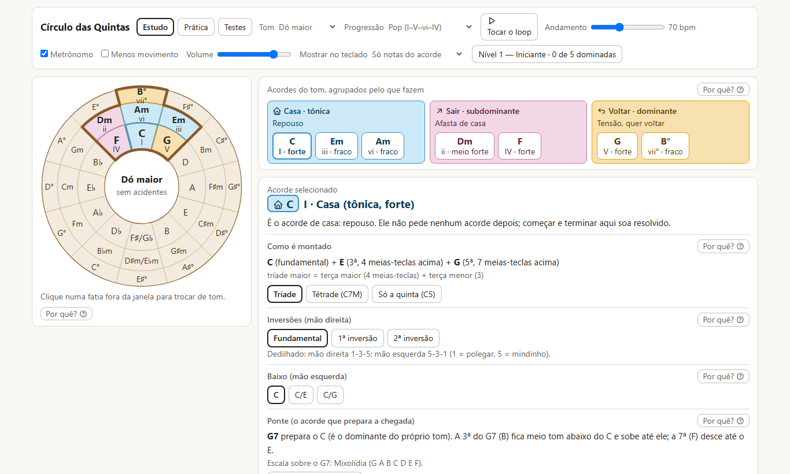
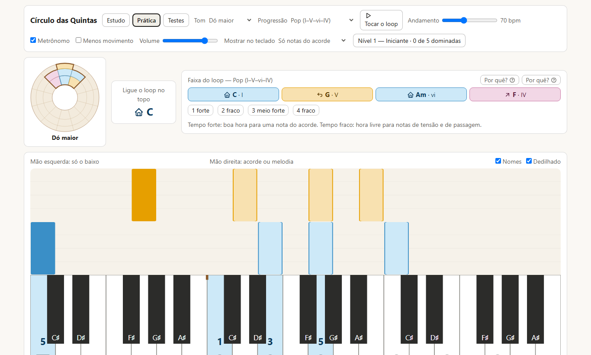
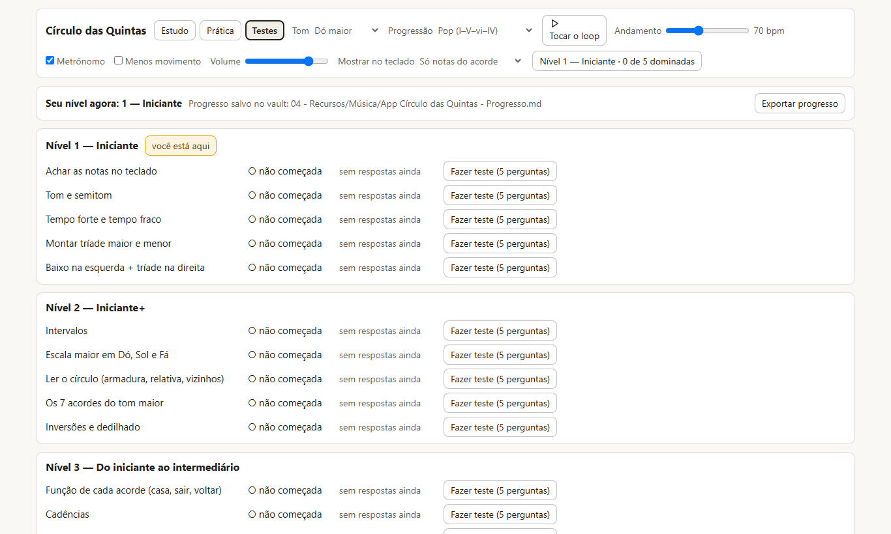

# Círculo das Quintas — learn to improvise on the keyboard

> 🇧🇷 **Resumo:** app que eu fiz para mim mesmo aprender a improvisar no teclado. Ele mostra o círculo das quintas, toca progressões em loop, mostra no teclado o que tocar com cada mão e testa o que eu já dominei. Feito com IA (Claude Code) em 4 dias (v0.5), com 127 testes automatizados e ferramentas que "ouvem" o próprio app para conferir se o som está certo.



## Why I built it

I'm starting on the keyboard. I could play two notes I liked and stop there. Music theory books explain the circle of fifths, but none of them show **what to play right now, with each hand, over a loop**. So I built the tool I wanted.

## What it does

- **Study tab:** pick any of the 24 keys. The chords of the key are grouped by what they *do* (home, leave, come back), with an explanation for every piece of information ("Por quê?").
- **Practice tab:** a progression plays in a loop with a metronome. Notes fall onto a keyboard showing the left hand (bass) and the right hand (chord or melody), with fingering.
- **Tests tab:** questions organised in a 7-level map. Progress is saved **automatically** to a Markdown file, so my AI assistant can read what I have and haven't mastered and plan my next study session.
- **Accessible by design:** colour is never the only signal (colour + icon + text), a colour-blind-safe palette (Okabe-Ito), and a "less movement" switch.

| Practice | Tests |
|---|---|
|  |  |

## The interesting part: an app that checks its own sound

You can't unit-test whether a chord *sounds* right. So I built automated listening tools (`ferramentas/`):

1. **Record:** Playwright opens the app in a headless browser and records video and audio of the loop.
2. **Listen to rhythm and chords:** `librosa` checks metronome beats (missing, drifting, late) and detects the chord in each bar.
3. **Listen note by note:** Spotify's **Basic Pitch** model (ONNX) transcribes the first bars and compares them with the expected bass and right-hand notes.

This turned "does it sound right?" from a human opinion into a repeatable check.

## How I built it (with AI)

- **Spec first:** a written design (goals, levels, accessibility rules, what is out of scope), approved before any code.
- **Plan → tasks → tests:** implemented task by task with Claude Code, test-first. 127 tests (Vitest + Testing Library).
- **Real failure cases tested:** for example, "the cloud drive is offline when the app opens" must never erase answers already saved.
- **Frozen versions:** every finished version gets a git tag and a frozen copy, so experiments never break what already works.
- **Security check:** `npm audit` and `pip-audit` with 0 known vulnerabilities (24 Oct 2026).

v0.5 was built between 23 and 26 October 2026.

## Stack

| Part | Tech |
|---|---|
| UI | React 19, TypeScript, Tailwind CSS 4, Vite |
| State | Zustand |
| Music theory | tonal |
| Audio | Tone.js, smplr (sampled piano) |
| Local server | Node.js (serves the app and writes the progress file) |
| Tests | Vitest, Testing Library, jsdom |
| Audio QA | Playwright, librosa, Basic Pitch |

## Run it

```bash
npm install
npm test              # 127 tests
npm run build
npm run servidor      # http://127.0.0.1:5180
```

Progress is written to `teste-local/Progresso.md` (change it in `config.json`).

## Roadmap

- v1.0 (in progress): melodic "bridge" between chords and accompaniment patterns.
- Next: publish a static demo (the app should work without the local server, only without saving progress).
